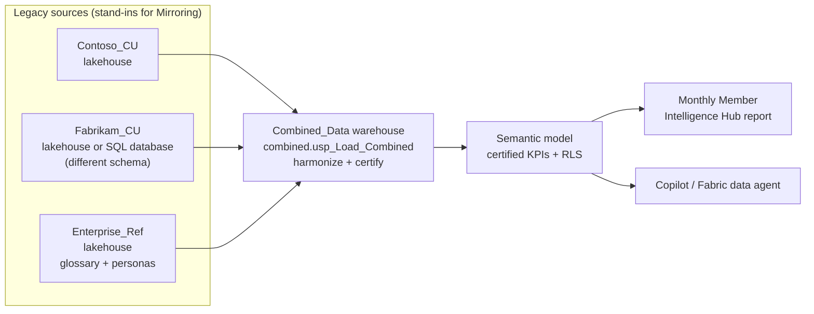

# Credit Union Merger on Microsoft Fabric — Demo Kit

A ready-to-install Microsoft Fabric demo that tells one story end to end:

> **Two credit unions have merged. Their data still lives in two systems, with two schemas and two definitions of the same KPI. Fabric brings it together into one certified source of truth that any employee can question in plain language — with the right security, a human in the loop, and governance a regulated institution needs.**

Everything here is **synthetic**. The two legacy organizations are **Contoso CU** and **Fabrikam CU**.

---

## What you can show

| Act | Story beat | Fabric / Power BI capability |
|---|---|---|
| 1 | Same KPI, two definitions, two numbers | Business glossary, metric standardization |
| 2 | Two sources harmonized into one certified layer | OneLake, lakehouses, cross-database T-SQL, warehouse, semantic model, Git, deployment pipelines, lineage |
| 3 | A regional director asks questions in plain English | Copilot in Power BI (or a Fabric data agent), row-level security, grounded answers |
| 4 | One branch is off track — why? | Anomaly spotting, drill-through to drivers, AI summary with human review |
| 5 | It rolls up to the executive scorecard | Certified KPIs, consistent results, board-ready narrative |
| 6 | Prove it's safe | Admin controls for AI, auditing (optionally Purview / Sentinel) |
| 7 | Run it at scale | Performance analyzer, Monitoring hub, Capacity Metrics, inventory and stale-content governance |

See **[docs/03-demo-script.md](docs/03-demo-script.md)** for the click-by-click script and talk track.

## Architecture



In production the sources would typically arrive through **Fabric Mirroring** (Snowflake, Azure SQL, Oracle and others). The lakehouses stand in for mirrored databases so the demo installs in any tenant in about 30 minutes. An optional **Fabric SQL database** source lets you show a live change flowing through with no ETL.

## Quick start

1. Check the **[prerequisites](docs/01-prerequisites.md)** (capacity, tenant settings, six demo users).
2. Follow **[setup](docs/02-setup.md)**:
   - create a workspace and three lakehouses,
   - run `fabric/notebooks/Load_Source_Data.ipynb`,
   - create the `Combined_Data` warehouse and run the three scripts in `fabric/warehouse/`,
   - open `powerbi/Monthly Member Intelligence Hub.pbip`, set two parameters, publish,
   - add the personas to the **Security Scope** role.
3. Rehearse with **[the demo script](docs/03-demo-script.md)**. Reset between runs with **[reset & troubleshooting](docs/04-reset-and-troubleshoot.md)**.

## Repository layout

```
├── data/
│   ├── generate_data.py          # regenerate all CSVs (seeded, standard library only)
│   ├── contoso_cu/               # legacy CU #1 - "clean" schema
│   ├── fabrikam_cu/              # legacy CU #2 - different names, codes and units
│   └── enterprise_ref/           # certified glossary, personas, sample platform telemetry
├── fabric/
│   ├── notebooks/
│   │   ├── Load_Source_Data.ipynb          # CSV -> Delta in the three lakehouses
│   │   └── optional/Fabric_Governance.ipynb # inventory, stale content, ownership (Act 7)
│   └── warehouse/
│       ├── 01_create_objects.sql
│       ├── 02_usp_Load_Combined.sql        # the merger logic
│       └── 03_validate.sql                 # checks + demo queries
├── powerbi/                      # Power BI Project (PBIP / TMDL) - model + report
├── optional/sql-database/        # Fabrikam as a live Fabric SQL database
└── docs/                         # prerequisites, setup, demo script, reset, customize
```

## Demo personas

| Persona | UPN prefix | Sees | Role in the demo |
|---|---|---|---|
| Management analyst | `mgmt_analyst` | All regions | Builds and certifies (Act 2) |
| West regional director | `west_director` | West only | Asks questions with Copilot (Act 3) |
| East regional director | `east_director` | East only | RLS comparison (Act 3) |
| North / South directors | `north_director`, `south_director` | Their region | Backups |
| Retail banking executive | `retail_exec` | All regions | Scorecard and drill-through (Acts 4–5) |
| Fabric admin | your admin account | — | Governance and operations (Acts 6–7) |

## Built-in storylines in the data

- **Branch code collisions:** both credit unions number their branches `BR001`, `BR002`, … — the warehouse creates a merged key (`CON-BR001`, `FAB-BR001`).
- **Different schemas:** Fabrikam uses different table and column names, region codes (`N/S/E/W`) and stores rates as fractions.
- **Two definitions of delinquency:** Fabrikam's legacy board metric is **60+ days** past due; the certified enterprise metric is **30+ days**. Same portfolio, roughly half the number.
- **A branch that stands out:** Fabrikam **Worcester** deteriorates over the last three months (delinquency ~1% → ~3%, NPS ~63 → ~41), driven by call-center wait time and staffing.
- **A merger moment in RLS:** the West region contains branches from **both** legacy organizations (California from Contoso, Denver from Fabrikam — the highest West delinquency).

## Customize

Rename the credit unions, add a third one, change the date range, or swap the lakehouses for real Mirroring — see **[docs/05-customize.md](docs/05-customize.md)**.

## Disclaimer

Sample code and synthetic data for demonstration purposes only, provided as-is with no warranty. Not an official Microsoft product. Any resemblance of the fictitious organizations to real institutions is coincidental.
